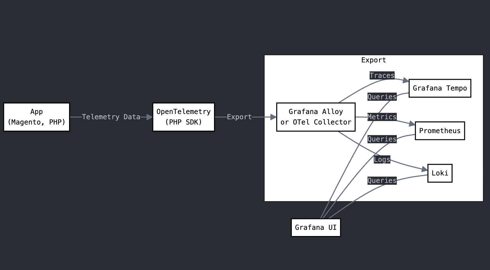
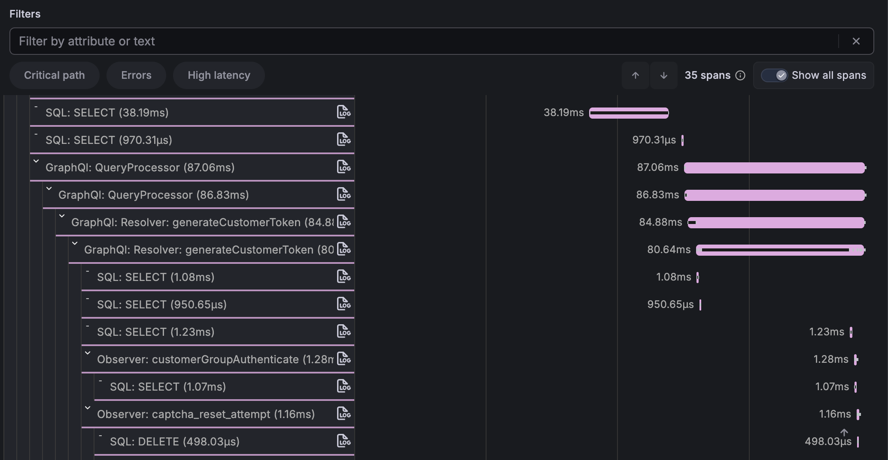

<div align="center">


# Magento 2 OpenTelemetry Instrumentation

OpenTelemetry integration package for Magento 2 applications with complete observability stack

[](https://packagist.org/packages/magepsycho/magento2-opentelemetry)
[](https://packagist.org/packages/magepsycho/magento2-opentelemetry/stats)


</div>

## 📖 Overview

A Composer library that adds [OpenTelemetry](https://opentelemetry.io/) tracing to Magento 2. It hooks into Magento core classes at runtime to automatically create spans for:

- **HTTP requests** — storefront, REST API, GraphQL, Backend admin, HTTP client
- **Database** — SQL query tracing
- **Cache** — Page cache, Redis, Varnish
- **CLI** — Commands, cron jobs, indexer operations
- **Entity** — EAV and flat entity load/save
- **Business logic** — Pricing, shipping, inventory, sales rules, repositories

## 🔄 OpenTelemetry Flow



## 📊 Grafana Traces



## ⚙️ How OpenTelemetry PHP SDK Works Under the Hood

```
1. PHP registers shutdown handler:
   OpenTelemetry\SDK\Common\Util\ShutdownHandler::register()

2. During shutdown:
   │
   └─> OpenTelemetry\SDK\Common\Util\ShutdownHandler::handleShutdown()
       │
       └─> Executes registered callbacks including:
           │
           └─> OpenTelemetry\SDK\Trace\TracerProvider->shutdown()
               │
               └─> Delegates to:
                   │
                   └─> OpenTelemetry\SDK\Trace\TracerSharedState->shutdown()
                       │
                       └─> Processes all span processors:
                           │
                           └─> OpenTelemetry\SDK\Trace\SpanProcessor\BatchSpanProcessor->shutdown()
                               │
                               └─> Final flush:
                                   │
                                   └─> OpenTelemetry\SDK\Trace\SpanProcessor\BatchSpanProcessor->flush()
                                       │
                                       └─> Delegates export to:
                                           │
                                           └─> OpenTelemetry\Contrib\Otlp\SpanExporter->export()
                                               │
                                               ├─> Serializes spans
                                               └─> Makes network call to collector
```

## 📋 Prerequisites

- PHP 8.0+
- PECL
- Composer
- OpenTelemetry PHP extension + PHP SDK
- Magento Application
  - Docker
  - Host

## 🔧 OpenTelemetry Setup

### 1. Install OpenTelemetry PHP Extension

```bash
pecl install opentelemetry
```

### 2. Configure the .ini Settings

Add the following to your PHP `.ini` file (e.g. `php.ini` or a custom `opentelemetry.ini`):

```ini
OTEL_PHP_AUTOLOAD_ENABLED="true"
OTEL_SERVICE_NAME=magento2
OTEL_TRACES_EXPORTER=otlp
OTEL_EXPORTER_OTLP_PROTOCOL=http/protobuf
OTEL_EXPORTER_OTLP_ENDPOINT=http://[COLLECTOR-IP]:4318
OTEL_PROPAGATORS=baggage,tracecontext
;OTEL_PHP_DISABLED_INSTRUMENTATIONS=magento2
;OTEL_PHP_EXCLUDED_URLS="health_check.php,get.php"
;OTEL_MAGENTO_FRONTEND_INSTRUMENTATION=true
;OTEL_MAGENTO_MISC_INSTRUMENTATION=true
;OTEL_MAGENTO_LOG_INSTRUMENTATION=true
```

Web requests are only traced under `/rest/`, `/admin/`, `/backend/` and `/graphql` by default. Set
`OTEL_MAGENTO_FRONTEND_INSTRUMENTATION=true` to trace storefront pages as well; `get.php`, `static.php`,
`health_check.php` and `cron.php` stay excluded either way. `OTEL_MAGENTO_LOG_INSTRUMENTATION=true` turns
on log and trace correlation (see [Request Totals and Logs](#-request-totals-and-logs)). All `OTEL_MAGENTO_*`
flags are read from the environment or the `.ini`, like the settings above.

### 3. Verify the Extension

```bash
php -m | grep opentelemetry
php --ri opentelemetry
```

### 4. Install the PHP SDK

```bash
composer require open-telemetry/sdk open-telemetry/api open-telemetry/sem-conv open-telemetry/exporter-otlp
```

> **Note:** These packages are automatically installed as dependencies when you install `magepsycho/magento2-opentelemetry`. You only need to install them manually if you're setting up OpenTelemetry without this package.

## 📦 Package Installation

```bash
composer require magepsycho/magento2-opentelemetry
```

No Magento module setup is needed — the package bootstraps automatically via Composer's autoload mechanism.

### Migrating from `mumzworld/magento2-opentelemetry`

Remove the old package first — both register the same runtime hooks, so running them together emits duplicate spans:

```bash
composer remove mumzworld/magento2-opentelemetry
composer require magepsycho/magento2-opentelemetry
```

The PHP namespace changed from `Mumzworld\OpenTelemetry\` to `MagePsycho\OpenTelemetry\`. If you referenced any class directly, update those imports.

## 🔗 Distributed Tracing

Magento participates in traces that start elsewhere, and passes its own context onward.

**Inbound** — the trace context is extracted in `Bootstrap::run()`, which is where the root span opens.
Extracting any later would leave an unparented local root above a remote-parented child and split the
trace in two. The carrier is `$_SERVER`, since no request object exists that early.

**Outbound** — every HTTP client listed below injects the current span's context into the request
headers, so the receiving service continues the same trace rather than starting a new one.

Which headers travel is decided by `OTEL_PROPAGATORS` (see the `.ini` settings above) — `tracecontext`
emits `traceparent`/`tracestate`. Requests without trace headers are unaffected, and CLI runs simply
start their own trace.

> Spans record **host and path only**, never the full URL with its query string, and the route is
> masked — `/V1/orders/40021` is reported as `/V1/orders/{id}` so one span name covers every order
> instead of one per order.

## 🔍 What Is Auto-Instrumented

Once installed, this package automatically instruments the following Magento areas — no code changes required.

### Core

| Instrumentation | Hooked Class | Method |
|-----------------|-------------|--------|
| Magento Bootstrap | `Magento\Framework\App\Bootstrap` | `run()`, `terminate()` |
| Exception Handling | `Magento\Framework\App\Http` | `catchException()` |
| Profiler | `Magento\Framework\Profiler` | `start()`, `stop()` |
| Event Observers | `Magento\Framework\Event\InvokerInterface` | `dispatch()` |
| Named Locks | `Magento\Framework\Lock\LockManagerInterface` | `lock()`, `unlock()` |
| Lock-Guarded Cache Loads | `Magento\Framework\Cache\LockGuardedCacheLoader` | `lockedLoadData()` |
| Log Correlation (opt-in) | `Monolog\Logger` | `addRecord()` |
| Error Messages | `Magento\Framework\Message\Manager` | `addMessage()` |

> Error messages shown to the customer or admin user become a `magento.message` event on the span that raised
> them — Magento turns many failures (out of stock, payment declined) into a message and a redirect rather than
> an exception, so the trace would otherwise look like a success.
>
> `Cache: lockedLoadData` is recorded only for a load that **regenerated** its data or **waited** for
> another request to do so (`magento.cache.hit`, `magento.cache.lock.waited`, `magento.cache.load_attempts`,
> `magento.cache.lock.attempts`) — the cold-cache and stampede cases. Hits, nearly all calls, cost nothing
> and get no span. The loader's own lock calls are counted on it rather than traced separately.

### HTTP

| Instrumentation | Hooked Class | Method |
|-----------------|-------------|--------|
| REST API | `Magento\Webapi\Controller\Rest\Interceptor` | `dispatch()` |
| REST Exceptions | `Magento\Framework\Webapi\Exception` | `__construct()` |
| GraphQL Dispatch | `Magento\GraphQl\Controller\GraphQl\Interceptor` | `dispatch()` |
| GraphQL Query | `Magento\Framework\GraphQl\Query\QueryProcessor` | `process()` |
| GraphQL Resolver | `Magento\Framework\GraphQl\Query\ResolverInterface` | `resolve()` |
| Storefront | `Magento\Framework\App\FrontController` | `dispatch()` |
| Session | `Magento\Framework\Session\SaveHandler` | `read()`, `write()` |
| Built-in Page Cache | `Magento\Framework\App\PageCache\Kernel` | `load()` |
| Backend Admin | `Magento\Backend\App\AbstractAction` | `dispatch()` |
| HTTP Client (Guzzle) | `GuzzleHttp\Client` | `send()` |
| HTTP Client (Magento) | `Magento\Framework\HTTP\ClientInterface` | `get()`, `post()` |
| HTTP Client (Laminas) | `Magento\Framework\HTTP\LaminasClient` | `send()` |
| HTTP Client (async) | `Magento\Framework\HTTP\AsyncClientInterface` | `request()` |
| HTTP Transport | `Magento\Framework\HTTP\Adapter\Curl` | `write()`, `read()` |

> Storefront spans are named after the controller that served the request, not the URL:
> `Frontend: GET /catalog/category/view` covers every category page, rewritten URLs included. The URL
> itself is on `url.path`, and the product, category or CMS page id on `magento.entity.id`.
> Requires `OTEL_MAGENTO_FRONTEND_INSTRUMENTATION=true`. `customer/section/load` also records which
> sections it rebuilt, as `magento.customer.sections`.
>
> `Session: read` and `Session: write` carry `magento.session.size_bytes`, through Magento's save handler
> whatever the backend: a session bloated by a large quote or a module storing objects in it is a cost every
> request pays.
>
> A page served from the built-in full page cache is never routed, so there is no controller to name it
> after: every hit is `Frontend: GET (page cache)`, with the URL still on `url.path`. Each request the
> built-in cache was asked about carries `magento.page_cache.hit` (`true`/`false`), which gives the hit
> ratio. Varnish and Fastly hits never reach PHP and do not appear at all.

> Outbound spans record the **host and path only** — query strings routinely carry API keys and tokens.
> The Laminas client is the one that matters for checkout: PayPal Payflow, USPS, DHL and the currency
> imports all go through it, and it shares no interface with the other clients.

### Database

| Instrumentation | Hooked Class | Method |
|-----------------|-------------|--------|
| SQL Queries | `Magento\Framework\DB\Adapter\Pdo\Mysql` | `query()` |
| Collection Loads | `Magento\Framework\Data\Collection\AbstractDb` | `load()` |
| OpenSearch | `Magento\OpenSearch\Model\SearchClient` | `query()`, `bulkQuery()` |
| Elasticsearch 8 | `Magento\Elasticsearch8\Model\Client\Elasticsearch` | `query()`, `bulkQuery()` |

> `Collection: <Name>` spans (up to 300 per request) carry the class, table, page size and item count — the
> same collection loaded once per product is the N+1 at the model level. Loads of an already loaded collection
> get no span. `Search: query` records the index, the engine's own `took`, the hit total and the number of
> aggregations (layered navigation filters), never the query body; `Search: bulk` records indexing writes.

### Checkout

| Instrumentation | Hooked Class | Method |
|-----------------|-------------|--------|
| Place Order | `Magento\Quote\Model\QuoteManagement` | `placeOrder()` |
| Submit Quote | `Magento\Quote\Model\QuoteManagement` | `submit()` |

> Every channel — storefront checkout, REST, GraphQL — ends here. Spans carry `magento.payment.method`,
> `magento.quote.id`, `magento.quote.items_count` and, on success, `magento.order.id` and
> `magento.order.increment_id`. A failed placement throws, so it is an error span with the exception. No
> customer data is recorded.

### Cache

| Instrumentation | Hooked Class | Method |
|-----------------|-------------|--------|
| FormKey Flush | `Magento\PageCache\Observer\FlushFormKey\Interceptor` | `execute()` |
| Full Cache Flush | `Magento\CacheInvalidate\Observer\FlushAllCacheObserver` | `execute()` |
| Cache Invalidation | `Magento\PageCache\Observer\InvalidateCache` | `execute()` |
| Redis | `Magento\Framework\Cache\Backend\Redis` | `test()`, `save()`, `remove()`, `clean()` |
| Varnish Purge | `Magento\CacheInvalidate\Model\PurgeCache` | `sendPurgeRequest()` |
| Fastly Purge | `Fastly\Cdn\Model\PurgeCache` | `sendPurgeRequest()` |
| Cache Load Totals | `Magento\Framework\Cache\Frontend\Adapter\Symfony`, `...\Backend\Redis` | `load()` (counted, no span) |

> Magento 2.4.9 replaced the Zend cache backends with Symfony Cache, so the `Cache: Redis:` spans above
> only appear up to 2.4.8. Load and hit counts are taken on whichever class the version uses.

### CLI

| Instrumentation | Hooked Class | Method |
|-----------------|-------------|--------|
| CLI Runner | `Magento\Framework\Console\Cli` | `doRun()` |
| Console Commands | `Symfony\Component\Console\Command\Command` | `run()` |
| Cron Jobs (one trace per job) | `Magento\Cron\Observer\ProcessCronQueueObserver` | `tryRunJob()` |
| Reindex | `Magento\Indexer\Model\Processor` | `reindexAllInvalid()` |
| Mview Actions | `Magento\Framework\Mview\View` | `executeAction()` |
| Mview Execute | `Magento\Framework\Mview\ActionInterface` | `execute()` |
| Mview Changelog | `Magento\Framework\Mview\View\ChangelogInterface` | `clear()` |
| Queue Consumer | `Magento\Framework\MessageQueue\Consumer` | `dispatchMessage()` |
| Queue Batch Consumer | `Magento\Framework\MessageQueue\MessageProcessorInterface` | `process()` |
| Queue Consumer Name | `Magento\Framework\MessageQueue\ConsumerFactory` | `get()` |
| Queue Publish | `Magento\Framework\MessageQueue\PublisherInterface` | `publish()` |
| Queue Trace Propagation (RabbitMQ) | `Magento\Framework\Amqp\Exchange`, `...\Amqp\Bulk\Exchange` | `enqueue()` |

> Every message a consumer handles is the root of its own trace, `Queue: process <topic>`
> (`SpanKind::CONSUMER`), rather than a child of the `queue:consumers:start` span — a consumer runs for
> hours, and one trace per process would never finish. Each message trace links back to the process
> span, carries `messaging.destination.name`, `messaging.consumer.group.name`, `messaging.message.id`
> and `messaging.system`, and gets a fresh span budget, so the SQL limit is not used up by the first
> few messages. A batch consumer's merged batch is one trace, with `messaging.batch.message_count`.
>
> Publishing gets a `Queue: publish <topic>` span (`SpanKind::PRODUCER`). On RabbitMQ the trace context also
> travels in the message's `application_headers`, and the consumer's trace links back to the publishing span
> (`messaging.link.source=producer`) — an async REST call leads to the bulk operation that ran it. A link,
> not a parent, because the message may wait minutes or hours. The MySQL queue stores only topic and body,
> so there the publish span is all there is.

> Cron jobs work the same way: `cron:run` handles every due job of a group in one process, so each job is
> the root of its own trace, `Cron: <job_code>`, linked back to `Cli: cron:run`, with
> `magento.cron.group`, `magento.cron.schedule_id` and `magento.cron.status`. A job that fails is marked
> as an error even though `tryRunJob()` records the failure instead of throwing.

### Layout (storefront)

| Instrumentation | Hooked Class | Method |
|-----------------|-------------|--------|
| Layout XML Merge | `Magento\Framework\View\Model\Layout\Merge` | `load()` |
| Layout Generation | `Magento\Framework\View\Layout` | `generateElements()` |
| Result Rendering | `Magento\Framework\View\Result\Layout` | `renderResult()` |
| Block Rendering | `Magento\Framework\View\Element\AbstractBlock` | `toHtml()` |

> One `Block: <name-in-layout>` span per rendered block, up to 500 per request, with `magento.block.class`,
> `magento.block.template` and — for blocks with a cache lifetime — `magento.block.cache.hit`, which
> separates a block served from `block_html` from one that was rendered. Registered only with
> `OTEL_MAGENTO_FRONTEND_INSTRUMENTATION=true`.

### Entity (EAV)

| Instrumentation | Hooked Class | Method |
|-----------------|-------------|--------|
| Product | `Magento\Catalog\Model\ResourceModel\Product\Interceptor` | `load()`, `save()`, `delete()` |
| Category | `Magento\Catalog\Model\ResourceModel\Category\Interceptor` | `load()`, `save()`, `delete()` |
| Customer | `Magento\Customer\Model\ResourceModel\Customer\Interceptor` | `load()`, `save()`, `delete()` |
| Customer Address | `Magento\Customer\Model\ResourceModel\Address\Interceptor` | `load()`, `save()`, `delete()` |

### Entity (Flat)

| Instrumentation | Hooked Class | Method |
|-----------------|-------------|--------|
| Quote | `Magento\Quote\Model\ResourceModel\Quote` | `load()`, `save()`, `delete()` |
| Quote Item | `Magento\Quote\Model\ResourceModel\Quote\Item` | `load()`, `save()`, `delete()` |
| Order | `Magento\Sales\Model\ResourceModel\Order` | `load()`, `save()`, `delete()` |
| Order Item | `Magento\Sales\Model\ResourceModel\Order\Item` | `load()`, `save()`, `delete()` |
| Invoice | `Magento\Sales\Model\ResourceModel\Order\Invoice` | `load()`, `save()`, `delete()` |
| Credit Memo | `Magento\Sales\Model\ResourceModel\Order\Creditmemo` | `load()`, `save()`, `delete()` |

### Business Logic (Misc)

> **Opt-in.** This group is **disabled by default** — it produces the highest-volume spans (per-rule sales-rule evaluation, repository calls, pricing/tax calculation, address totals, etc.) and is best enabled selectively. Activate it by setting `OTEL_MAGENTO_MISC_INSTRUMENTATION=true` in your `.ini` or environment (`.env`, `docker-compose.yml`, nginx `fastcgi_param`, `php-fpm` pool, or `export` for CLI).

| Instrumentation | Hooked Class | Method |
|-----------------|-------------|--------|
| Abstract DB | `Magento\Framework\Model\ResourceModel\Db\AbstractDb` | `load()`, `save()`, `delete()` |
| Product Repository | `Magento\Catalog\Model\ProductRepository` | `get()`, `getById()` |
| Category Repository | `Magento\Catalog\Model\CategoryRepository` | `get()` |
| Customer Repository | `Magento\Customer\Model\ResourceModel\CustomerRepository` | `get()`, `getById()` |
| Shipping Rates | `Magento\Shipping\Model\Shipping` | `collectRates()` |
| Final Price | `Magento\Catalog\Model\Product\Type\Price` | `getFinalPrice()`, `_applyTierPrice()` |
| Tax Calculation | `Magento\Tax\Model\Calculation` | `getRate()` |
| Sales Rules | `Magento\SalesRule\Model\Validator` | `process()` |
| Inventory | `Magento\CatalogInventory\Observer\QuantityValidatorObserver` | `execute()` |
| Totals Collector | `Magento\Quote\Model\Quote\TotalsCollector\Interceptor` | `collectAddressTotals()` |
| Address Totals | `Magento\Quote\Model\Quote\Address\Total\AbstractTotal` | `collect()` |
| Totals Collector | `Magento\Quote\Model\Quote\Address\Total\Collector` | `collect()` |
| Discount Calc | `Magento\SalesRule\Model\Rule\Action\Discount\AbstractDiscount` | `calculate()` |

## 📈 Request Totals and Logs

Every root span — HTTP request, CLI command, queue message, cron job — ends with totals for its unit of work.
They are counted whether or not the matching spans were recorded, so they stay true past the span limits:

| Attribute | Meaning |
|-----------|---------|
| `magento.sql.count` | Queries run |
| `magento.sql.distinct_count` / `magento.sql.duplicate_count` | Distinct statement shapes, and repeats of them |
| `magento.sql.top_duplicate` / `magento.sql.top_duplicate_count` | The most repeated statement shape — the N+1 candidate |
| `magento.cache.load_count` / `magento.cache.hit_count` | Cache loads and hits |
| `magento.spans.dropped.<kind>` | Spans not recorded because a limit was reached (`sql`, `block`, `lock`, `collection`) |
| `magento.memory.peak_bytes` | Peak PHP memory |

A statement shape is the query with its literals, numbers and `IN` lists replaced, so the same lookup run once
per product counts as one shape repeated.

**Log and trace correlation** (opt-in, `OTEL_MAGENTO_LOG_INSTRUMENTATION=true`):

- Every log record written inside a span gets `trace_id` and `span_id` in its context, so a line in
  `var/log/system.log` or `exception.log` leads to its trace.
- Records at `ERROR` and above are added to the open span as a `log` event (`log.severity`, `log.channel`,
  `log.message`), with the exception recorded and the span marked as an error when one is passed in the
  context. A trace then shows the errors Magento caught and logged, not only the ones it threw.

## 🚀 Optimization Tips

### Install `ext-protobuf` PHP Extension

Preferred over the pure-PHP library `google/protobuf` for production:

```bash
pecl install protobuf
```

| Option | Package | Performance |
|--------|---------|-------------|
| **C extension (recommended)** | `ext-protobuf` via `pecl install protobuf` | Native speed, minimal overhead |
| Pure-PHP library | `google/protobuf` via Composer | Slower serialization, higher CPU usage |

> **NOTE:** To reduce the latency imposed by the OTel exporter:
> 1. Use a local OTel collector (instead of remote)
> 2. Use the `ext-protobuf` C extension instead of the Composer package

### Limiting the Number of Spans

See [OpenTelemetry SDK Environment Variables — Attribute Limits](https://opentelemetry.io/docs/specs/otel/configuration/sdk-environment-variables/#attribute-limits) for details on:

- Limiting the number of span attributes
- Limiting the length of span attribute values
- Limiting the number of events

### Export Settings

| Setting | Purpose | Default | Suggested | Effect of Tuning |
|---------|---------|---------|-----------|------------------|
| `OTEL_BSP_MAX_QUEUE_SIZE` | Max number of spans buffered in memory | 2048 | 10000+ | Prevents spans being dropped under high load |
| `OTEL_BSP_MAX_EXPORT_BATCH_SIZE` | Max spans exported per batch | 512 | 1000–5000 | Reduces export cycles, improves throughput |
| `OTEL_BSP_SCHEDULE_DELAY` | How often (ms) the processor checks the queue for exporting | 5000 ms | 100–200 ms | Faster flushing during long-running requests |
| `OTEL_BSP_EXPORT_TIMEOUT` | Max time (ms) allowed for a single export batch | 30000 ms | 1000–2000 ms | Prevents request shutdown from blocking if exporter is slow/hangs |

## ⚡ Performance Considerations

- **Sampling:** Use appropriate sampling rates for production (`0.1` = 10%)
- **Batching:** Configure batch processors in collector
- **Resource Limits:** Set memory and CPU limits
- **Network:** Use gRPC for better performance
- **Storage:** Configure appropriate retention policies

## 🤝 Contributing

1. Fork the repository
2. Create a feature branch
3. Make your changes
4. Add tests
5. Submit a pull request

## 📄 License

This package is licensed under the [MIT License](LICENSE).

## 💬 Support

For support and questions:

- Create an issue in the repository
- Check the troubleshooting section
- Review the [Magento 2 OpenTelemetry documentation](README.md)

---

Built with ❤️ by [MagePsycho](https://www.magepsycho.com)

## 📄 License & Attribution

Released under the [MIT License](LICENSE).

This package is derived from [mumzworld-tech/magento2-opentelemetry](https://github.com/mumzworld-tech/magento2-opentelemetry), Copyright (c) 2025 mumzworld, licensed under MIT. The original copyright notice is retained in [LICENSE](LICENSE) and in the source file headers, as the MIT License requires.
