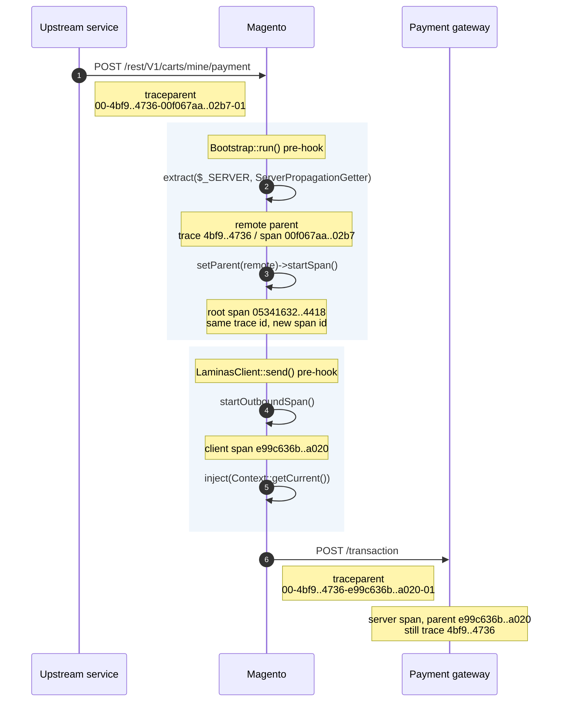
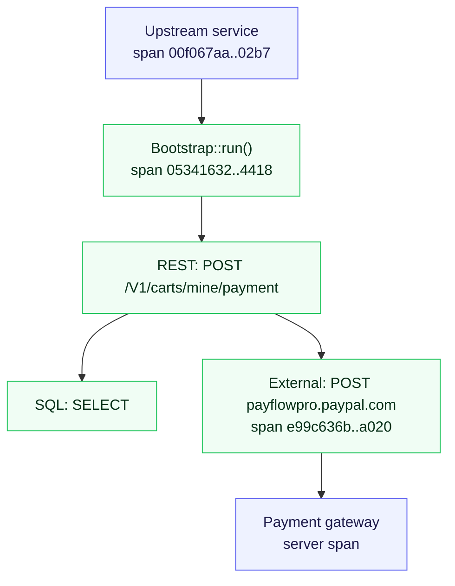
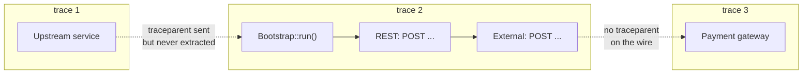
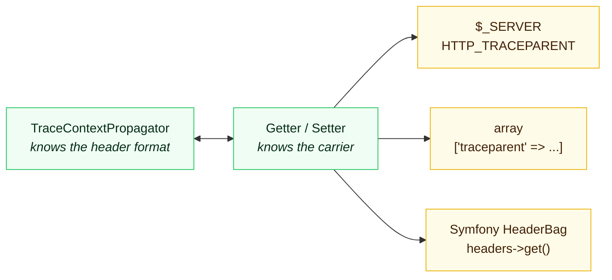

# Distributed Tracing — How Context Propagation Works

Reference for how this package joins traces that start elsewhere and passes its own context onward.
Written against the implementation in `src/Instrumentation/Core/MagentoInstrumentation.php`,
`src/Instrumentation/Util/Http/ServerPropagationGetter.php` and
`src/Instrumentation/Http/HttpClientInstrumentation.php`.

## The goal, in one output

A request arriving from another service, passing through Magento, and calling out to a third:

```
inbound header   : 00-4bf92f3577b34da6a3ce929d0e0e4736-00f067aa0ba902b7-01
extracted        : trace=4bf92f3577b34da6a3ce929d0e0e4736 span=00f067aa0ba902b7 remote=true
root span        : trace=4bf92f3577b34da6a3ce929d0e0e4736 span=05341632ac204418
client span      : trace=4bf92f3577b34da6a3ce929d0e0e4736 span=e99c636be21da020
outbound header  : 00-4bf92f3577b34da6a3ce929d0e0e4736-e99c636be21da020-01
```

One trace id, four spans, three processes. Without propagation each process invents its own trace id
and the backend shows three unrelated traces.

## The journey of one trace id



The trace id never changes. The span id in the header is always *the span that is sending*, which is
why the receiving service always knows exactly what to hang itself under.

## What the backend then shows



Green is this package's spans; blue is other processes. One tree, one trace id, three services.

## Without propagation — the state before this change



The header arrived and was written into an attribute; the span it sat on belonged to a different,
locally generated trace. The dotted edges are the links a human had to make by hand.

## The header

`traceparent` is a [W3C standard](https://www.w3.org/TR/trace-context/) with four dash-separated fields:

```
00 - 4bf92f3577b34da6a3ce929d0e0e4736 - 00f067aa0ba902b7 - 01
^^   ^^^^^^^^^^^^^^^^^^^^^^^^^^^^^^^^   ^^^^^^^^^^^^^^^^   ^^
version  trace id (16 bytes)             span id (8 bytes)  flags (01 = sampled)
```

- **trace id** — the correlation key. Every span in the distributed trace carries it.
- **span id** — identifies *the span that sent this request*, so it becomes the receiver's parent.
- **flags** — sampling decision, so downstream services honour the same choice instead of each
  sampling independently.

## Two operations

A propagator is a codec with exactly two methods:

| Method | Direction | What it does |
|---|---|---|
| `extract($carrier, $getter)` | inbound | Reads headers, returns a `Context` holding a **non-recording** span whose SpanContext has `isRemote=true` |
| `inject($carrier, $setter, $context)` | outbound | Serialises whatever span is in that context back into headers |

The extracted span is a placeholder for something living in another process — no timing, no
attributes, just identity. It exists to be a parent.

## Carriers, getters and setters

The propagator does not know what an HTTP request is. It reaches the carrier through an adapter, which
is why every framework instrumentation ships its own getter and setter, and why this package needed
`ServerPropagationGetter`:

```php
$getter->get($_SERVER, 'traceparent');    // reads HTTP_TRACEPARENT
$getter->get($_SERVER, 'content-type');   // reads CONTENT_TYPE — PHP does not prefix this one
```

Compare: Symfony's getter calls `$carrier->headers->get($key)`; Yii's reads its own request object.
Same propagator, different carrier.



The split is the whole point: swapping `OTEL_PROPAGATORS` changes the left box, supporting a new
framework changes the right one, and neither knows about the other.

**Why `$_SERVER` and not Magento's request?** Because extraction has to happen in `Bootstrap::run()`
(see below), and no request object exists that early. `$_SERVER` is what PHP populates from the actual
request headers, and it is available immediately.

For outbound the built-in `ArrayAccessGetterSetter` is used — the carrier is a plain array that each
client hook then copies onto its request in whatever form that client wants.

## Parenting: where linkage actually happens

`extract()` on its own changes nothing. The join happens when the span builder is given that context:

```php
$builder->setParent($remoteContext)->startSpan();
```

The new span **inherits the trace id** and **records the remote span id as its parent**. That is the
jump in the output above from `00f067aa0ba902b7` (the caller's span, in another process) to
`05341632ac204418` (our root) — a different span, the same trace.

In this package that is `SpanBuilderTrait::startSpanAndAttachToContext($builder, $parent)`, whose
second argument defaults to the current context so every other call site is unaffected.

## Why extraction lives in `Bootstrap::run()`

Every span this package creates nests below the `Bootstrap::run()` span — it is the trace root for an
HTTP request. Extracting anywhere lower, say in the REST or GraphQL hook, would produce:

```
Bootstrap::run()          <- unparented, invents a NEW trace id
└── REST: GET /V1/orders  <- parented to the remote context, DIFFERENT trace id
```

Two traces, neither complete. Extraction must happen at the outermost span or not at all.

## `Context::getCurrent()`

Context is an immutable stack held in ambient storage. `startSpanAndAttachToContext()` pushes,
`endSpan()` pops. So "which span am I inside?" is answerable anywhere without threading a parameter
through — which is what lets a hook deep inside a curl client know it belongs under a REST span it
never saw.

## Why injection runs *after* the span starts

`traceHeaders()` injects `Context::getCurrent()`, which resolves to whatever is innermost at that
moment. In the output above the client span was active, so the header carries `e99c636be21da020` —
the client span, not the root. Downstream, the remote service's server span becomes that span's child
and the trace nests correctly.

Hence the ordering in `hookOutboundCall()`:

```php
self::startOutboundSpan(...);                                 // push the client span
return $inject === null ? null : $inject($subject, $params);  // now serialise it
```

Inject first and downstream would parent itself to whatever called the HTTP client, rather than to the
HTTP call itself.

## Per-client injection

Each client stores headers differently, so each gets its own injector:

| Client | Mechanism | Why |
|---|---|---|
| `GuzzleHttp\Client` | `withHeader()`, replace `$params[0]` | PSR-7 requests are immutable |
| `HTTP\ClientInterface` | `$subject->addHeader()` | Headers live on the client, not in the call. Guarded with `method_exists` — `addHeader()` is on `Client\Curl` and `Client\Socket` but not on the interface |
| `HTTP\LaminasClient` | mutate the request's `Headers` bag | Laminas *appends*, so an existing header is removed first |
| `HTTP\AsyncClientInterface` | build a replacement `AsyncRequest` | `AsyncClient\Request` has no setters |
| `HTTP\Adapter\Curl` | inject into `$params[3]`, **only if absent** | Laminas hands its already-injected headers straight down; injecting again would put a second `traceparent` on the wire |

Replacement parameters work because an `ext-opentelemetry` pre-hook may return an array that replaces
the call's arguments positionally.

The duplicate guard asks the propagator which headers it would write (`fields()`) rather than
hardcoding `traceparent`, and handles both carrier shapes Magento's `normalizeHeaders()` accepts —
associative `['traceparent' => '00-…']` and raw lines `['traceparent: 00-…']`.

## Configuration

`Globals::propagator()` is resolved once by the SDK autoloader from `OTEL_PROPAGATORS`:

| Value | Headers written |
|---|---|
| `tracecontext` | `traceparent`, `tracestate` |
| `baggage` | `baggage` |
| `b3` / `b3multi` | `b3` / `X-B3-TraceId`, `X-B3-SpanId`, … |

No header name is hardcoded anywhere in this package — the propagator is asked. Setting
`OTEL_PROPAGATORS=b3` makes the same code emit B3 with no edit.

**When nothing is configured** the propagator is a noop: `extract()` returns the context it was given
and `inject()` writes nothing. That is why CLI runs, cron, and requests from uninstrumented callers
simply start their own trace rather than failing.

## Verifying it

Standalone, no Magento required:

```php
$_SERVER['HTTP_TRACEPARENT'] = '00-4bf92f3577b34da6a3ce929d0e0e4736-00f067aa0ba902b7-01';

$context = Globals::propagator()->extract($_SERVER, ServerPropagationGetter::instance());
$parent  = Span::fromContext($context)->getContext();

echo $parent->getTraceId();      // 4bf92f3577b34da6a3ce929d0e0e4736
echo $parent->isRemote();        // true

$carrier = [];
Globals::propagator()->inject($carrier, ArrayAccessGetterSetter::getInstance(), $context);
echo $carrier['traceparent'];    // 00-4bf92f35…-00f067aa0ba902b7-01
```

Run it with the propagator actually configured, or `Globals::propagator()` returns the noop and every
assertion trivially passes:

```bash
OTEL_PHP_AUTOLOAD_ENABLED=true OTEL_PROPAGATORS=tracecontext \
OTEL_TRACES_EXPORTER=none OTEL_METRICS_EXPORTER=none OTEL_LOGS_EXPORTER=none \
php check.php
```

End to end, in a real install: send a request with a `traceparent` header and confirm the backend
shows the caller's trace id on Magento's spans, then confirm an outbound call from Magento arrives at
the receiving service with the same trace id and Magento's client span id.

## Message queues

HTTP carries the context in a header; a queued message has to carry it itself.

- **Inject.** `QueuePublisherInstrumentation` opens a `Queue: publish <topic>` span (`PRODUCER`) around
  `PublisherInterface::publish()`. On RabbitMQ, a pre-hook on `Amqp\Exchange::enqueue()` and
  `Amqp\Bulk\Exchange::enqueue()` replaces each envelope with a copy whose `application_headers` (an
  `AMQPTable`) gain `traceparent` - injected inside the publish span, so it names that span.
- **Extract.** `QueueConsumerInstrumentation` reads `application_headers` off the dequeued envelope and
  extracts the context with the same propagator.
- **Link, not parent.** The consumer's `Queue: process <topic>` span stays the root of its own trace and gets a
  span link to the producer (`messaging.link.source=producer`), next to its link to the consumer process. A
  message can wait minutes or hours; parenting it would stretch the publishing request's trace across the
  whole wait.
- **MySQL queue.** `queue_message` stores only the topic and the body, so there is nowhere to carry the
  context: the publish span is recorded, the link is not. Putting it in the body would change the payload
  every consumer decodes.

## Prior art

The implementations this design was checked against:

- [contrib-auto-symfony](https://github.com/opentelemetry-php/contrib-auto-symfony) — `RequestPropagationGetter`, `ResponsePropagationSetter`
- [contrib-auto-laravel](https://github.com/opentelemetry-php/contrib-auto-laravel) — `Hooks/Illuminate/Contracts/Http/Kernel.php`
- [contrib-auto-yii](https://github.com/opentelemetry-php/contrib-auto-yii) — `YiiInstrumentation.php`
- [tracewayapp/opentelemetry-symfony-bundle](https://github.com/tracewayapp/opentelemetry-symfony-bundle) — `HttpClient/TraceableHttpClient.php`, the model for outbound injection

## Not implemented yet

- **Response-side propagation.** Laravel and Yii inject context into the *response* via
  `Globals::responsePropagator()`, used to correlate browser/RUM timings with the server trace.
- **`Server-Timing`** header exposure, which usually accompanies the above.
